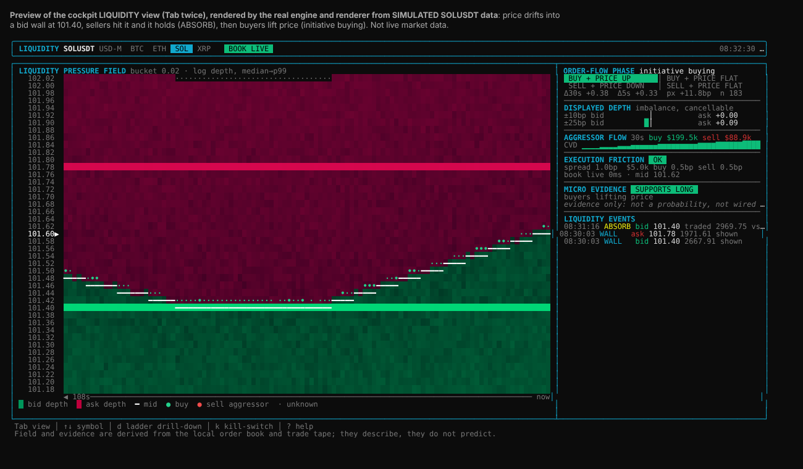

# Liquidity view (order book and tape, without a ladder)

`Tab` cycles the cockpit views: **cockpit → MTF → LIQUIDITY**. In the liquidity view:

- `↑` / `↓` select the symbol;
- `w` cycles the field span (2m / **5m** / 30m / 2h);
- `d` toggles the raw ladder, kept only as a diagnostic drill-down.

The view shows what the order book and the tape are *doing*. You don't have to rebuild that state from 100 price levels.



*The screenshot uses simulated data: price drifts into a 101.40 bid wall, sellers hit it and it holds (ABSORB), then
buyers lift price and the micro bias confirms LONG. The 5m column still shows the earlier selling into the wall. It is
not live market data.*

## Time horizons

Data is processed at stream cadence, while every opinion has its own, slower horizon:

| Layer | Horizon | Updates |
| --- | --- | --- |
| Book, spread, friction | live (100 ms depth diffs) | the entry gate reads it at order time; the screen samples it once a second |
| Order flow | rolling 5s · 30s · 2m · 5m, side by side | every second; a window longer than the unbroken live stretch is marked `*` |
| Pressure field | 2m / 5m / 30m / 2h (`w`) | 1 s columns (kept 5 m), 10 s columns (30 m), 60 s columns (2 h). Wider columns hold the time-averaged depth, so the shade shows persistence |
| Micro bias | persisted state | changes only by its confirmation rules (below) |
| Context | 15m / 1h / 4h closed candles | from the MarketState; never from the forming candle |

Risk is not delayed by any of this. The friction gate and the book-integrity checks act on the live book, and a book
that stops being live clears the bias at once.

## What each panel answers

| Panel | Question | Built from |
| --- | --- | --- |
| **Liquidity pressure field** (left) | Where is liquidity, and is price moving through it? | Time × price grid, one column per second. **Background:** displayed depth, green for bids and red for asks, on a log scale from the window's median to its 99th percentile, so walls stand out at any liquidity regime. **Overlays:** `━` is the mid path; `●`/`•` are executed aggressor volume (green buy, red sell); `·` is a cell never measured. |
| **Order flow** (table) | What are aggressors doing to price, now and over the backdrop? | One column per window (5s / 30s / 2m / 5m). **Trade Δ:** signed aggressor notional. **OFI/depth:** top-of-book order-flow imbalance (Cont–Kukanov–Stoikov), which counts limit adds and cancels, normalized by the average touch depth. **Price:** mid change in bp. **Phase:** `BUY↑` initiative buying, `BUY=` buying absorbed, `SELL↓`, `SELL=`, drift, balanced, thin. The price-move threshold scales with √window. A 5s burst against a 2m/5m backdrop reads as exactly that. |
| **Displayed depth** | How is resting size skewed? | Bid/ask quantity imbalance within ±10 and ±25 bps. It is labelled cancellable, because displayed depth costs nothing to pull. |
| **Aggressor flow** | Who is crossing the spread? | 30 s buy/sell notional and a CVD sparkline. |
| **Execution friction** | Can the planned size trade at an acceptable cost now? | Spread, plus depth-walked slippage for `MICRO_ORDER_NOTIONAL` on each side. OK / ELEVATED / BLOCK against `MICRO_MAX_SPREAD_BPS` and `MICRO_MAX_SLIP_BPS`. A book that is not live is always BLOCK. |
| **Liquidity events** | What happened to the walls? | `WALL`: a concentration that persisted for at least 3 s, so flicker is filtered out. `ABSORB`: aggressors traded at least the wall's size into it, the wall held at 70% or more of its peak, and price stayed on its side. `EATEN`: it shrank with matching executed volume, optionally with "price through". `PULLED`: it shrank without trades, i.e. it was cancelled. |
| **Micro bias** | What does the microstructure persistently support? | LONG / SHORT / NEUTRAL, how long it has been held, any pending change with its progress (`→ LONG 6/10s`), this second's raw evidence, and the closed-candle context with a conflict flag (`1h opposes bias`). Rules below. **Not a probability and not wired to orders.** |

## Micro bias rules (persistence and hysteresis)

| Change | Needs |
| --- | --- |
| NEUTRAL → LONG | 30 s window shows initiative buying, or selling absorbed at a bid wall, **and** the 2 m trade delta ≥ +0.10. Must hold continuously for **10 s**; any gap restarts the clock. |
| LONG held | Only the looser rule: 2 m delta > −0.10 and no initiative selling on 30 s. |
| LONG → NEUTRAL | The hold rule failing continuously for **30 s**. |
| LONG → SHORT | The SHORT entry rule holding continuously for 10 s. |
| Any → NEUTRAL immediately | The book is not live (syncing, resync, stale). |

SHORT mirrors LONG. Entry is stricter than hold, so the state does not flicker when one metric crosses zero. These
thresholds are starting points. Record readings and test them before giving the bias any role in trading.

## Data integrity

- Streams come through binance-sdk on USD-M: `<sym>@depth@100ms` and `<sym>@aggTrade`. The REST snapshot is
  `/fapi/v1/depth?limit=1000`.
- The local book follows Binance's procedure:
  1. Buffer diffs.
  2. Take the snapshot.
  3. Drop diffs with `u < lastUpdateId`.
  4. The first applied diff must straddle the snapshot.
  5. Every later diff must have `pu` equal to the previous `u`.
  6. A quantity of 0 removes the level.
- These all force a rebuild from a fresh snapshot: a sequence gap, a crossed book, a malformed level, or a stream
  reconnect.
- While a rebuild is in progress the view says `BOOK SYNCING` / `RESYNC` / `STALE` (no diff for 5 s). It withholds the
  field, and evidence reads INVALID. Nothing is interpolated.
- Cells beyond the snapshot range, or outside the band tracked at that moment, render as `·` (unknown), never as empty
  liquidity.
- Terminals without truecolor get a density ramp (`░▒▓█`) instead of background shading.

## Execution-friction entry gate

`MICRO_ENTRY_GATE` (default `on`) wires the friction verdict into futures entries. It is the last check before an
order is sent, after risk, the LLM veto and the execution-quality check.

- **What it measures.** Each `OPEN_*` entry is graded on the live local book for **its own side and size**. A long walks
  the asks for its notional, a short walks the bids. The grade covers:
  - the spread against `MICRO_MAX_SPREAD_BPS`;
  - the depth-walked VWAP slippage from mid against `MICRO_MAX_SLIP_BPS`.
- **Outcomes.**
  - `on`: a `BLOCK` verdict refuses the entry. It is journaled as `FRICTION_REJECTED` with the reason and the measured
    spread/slippage, and logged as `FRICTION BLOCK SOLUSDT sell $5000: sell slippage 13.0bps > 10`.
  - `ELEVATED` (above half a limit) passes.
  - `shadow`: blocks are only logged (`FRICTION (shadow) would block …`).
  - `off`: nothing is measured.
- **Fails closed.** With the gate on, these all refuse entries with that reason:
  - a book that is syncing, resyncing or stale (no diff for 5 s);
  - a missing feed, or a symbol with no book;
  - an order the known book cannot fill.

  A refused feed configuration leaves the gate on with no feed, so entries stop rather than trade unchecked.
- **Never gates exits.** `CLOSE` and every protective exit skip the gate.
- **Recorded on every entry.** Executed entries carry the measured friction in `execution.friction` of the decision
  journal, so the gate's thresholds can be reviewed against real fills.
- **Cannot be on without the feed.** `MICRO_ENTRY_GATE=on` (or `shadow`) with `MICROSTRUCTURE=off` is refused at
  startup.
- **Options are out of scope.** Option entries are not routed through this gate; they have their own spread and
  book-walk checks on the option book.

## Validating the directional features

`MICRO_RECORD=on` appends one reading per symbol per second to `data/microstructure/<date>/<SYMBOL>.jsonl`. Each reading
contains the phase, imbalance, flow, friction, evidence and events emitted that second. Outcomes (the mid N seconds
later) can be joined offline, then tested over 1 s / 5 s / 30 s / 1 m horizons, after fees and slippage, per volatility
regime. Until that shows value, the phase, imbalance and evidence are display and recording only. Only the
execution-friction verdict gates anything (above), because it measures cost, not direction.

## Settings

| Variable | Default | Meaning |
| --- | --- | --- |
| `MICROSTRUCTURE` | `on` | `off` stops the feed; the view says so. |
| `MICRO_BUCKET_BPS` | `1` | Field row height in bps of price (rounded to a clean step). |
| `MICRO_ORDER_NOTIONAL` | `5000` | Size the friction estimate walks the book for (USDT). |
| `MICRO_MAX_SPREAD_BPS` | `5` | Spread above which friction is BLOCK (ELEVATED above half). |
| `MICRO_MAX_SLIP_BPS` | `10` | Slippage above which friction is BLOCK (ELEVATED above half). |
| `MICRO_SAMPLE_MS` | `1000` | Sampling cadence (one field column per sample). |
| `MICRO_RECORD` / `MICRO_RECORD_DIR` | `off` / `data/microstructure` | Reading recorder. |
| `MICRO_ENTRY_GATE` | `on` | `on` refuses entries the book cannot absorb (fails closed), `shadow` only logs, `off` disables. |

Recorded readings (`MICRO_RECORD=on`) now include every window and the bias state, so the multi-window rules can be
tested offline against what followed.


## Offline microstructure evaluation

Use `MICRO_RECORD=on` to collect one JSONL reading per symbol per second, then evaluate whether recorded features are associated with subsequent mid-price movement:

```bash
npm run research:micro-eval
npm run research:micro-eval -- --input data/microstructure --sample-ms 1000
npm run research:micro-eval -- --fee-bps-per-leg 4 --train-fraction 0.7 --min-n 30
```

The evaluator:

- Reads the recorder's `data/microstructure/<UTC-date>/<SYMBOL>.jsonl` files; reports malformed records, duplicate timestamps, recording gaps, estimated missing samples and non-live readings.
- Rejects an outcome interval if its entry/exit book is not live, any intervening sample is non-live, the sample path has a gap, or the requested future timestamp is not observed within the sampling tolerance.
- Labels each eligible reading at 1 s, 5 s, 30 s and 1 m by default, for both LONG and SHORT. Net mid-to-mid movement subtracts configurable fees per leg and the entry-side plus exit-side depth-walked slippage measured from mid. Because these slippage figures already include spread, the spread is reported separately and is not charged a second time. The recorded friction uses the configured `MICRO_ORDER_NOTIONAL`, not an inferred fill size.
- Reports means and time-block bootstrap confidence intervals by flow window, phase, bias, OFI bucket and volatility regime. Five-minute realized volatility tertiles are fitted on the training period only, then applied to the holdout.
- Splits each symbol chronologically (70% train / 30% holdout by default). Labels that cross the split boundary are excluded. The holdout is for evaluation only; do not tune thresholds against it.

Useful options:

| Option | Default | Meaning |
| --- | --- | --- |
| `--input` | `data/microstructure` | Directory or comma-separated JSONL files |
| `--sample-ms` | `1000` | Expected recorder cadence; set this to match `MICRO_SAMPLE_MS` |
| `--horizons` | `1000,5000,30000,60000` | Future label horizons in milliseconds |
| `--fee-bps-per-leg` | `4` | Fee charged on each entry/exit leg |
| `--train-fraction` | `0.7` | Chronological training share per symbol |
| `--bootstrap-iterations` | `2000` | Bootstrap repetitions |
| `--block-seconds` | `30` | Time-block size for bootstrap resampling |
| `--confidence` | `0.95` | Confidence interval level |
| `--min-n` | `30` | Minimum sample size before reporting a CI |
| `--max-rows` | `500` | Maximum output rows to print |

The confidence interval describes uncertainty in the mean cost-adjusted move, **not** the probability that a trade wins. Highly overlapping 1-second labels are serially dependent, so the evaluator uses time-block bootstrap resampling rather than treating every sample as independent. Thin buckets are displayed without a confidence interval. This tool is research-only and does not change the micro-bias, execution gate, or order path.

Run the full repository check after changes:

```bash
npm run check
```
