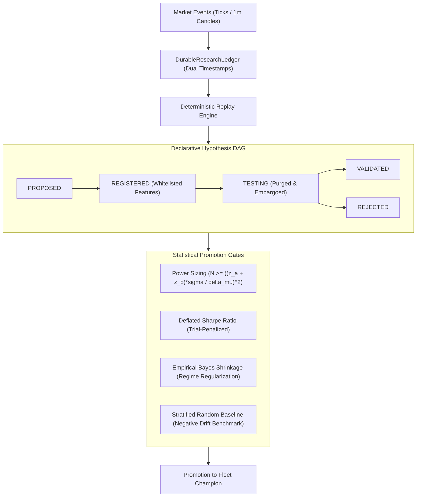

# Systematic Crypto Research & Validation Architecture

This document specifies the statistical foundations, data contracts, and verification protocols implemented in `crypto-trading-agent` to eliminate selection bias, lookahead leaks, and overfitting.

---

## 1. Architecture Overview



---

## 2. Pillar 1: Data Provenance & Timestamp Contract

To prevent lookahead and survival bias, market and execution records in `DurableResearchLedger` strictly enforce a three-timestamp contract:

1. **`exchange_time`**: The authoritative timestamp assigned by the exchange when the candle closed or the order fill matched.
2. **`received_at`**: The local monotonic wall-clock timestamp when the networking socket received the packet.
3. **`available_at`**: The earliest point in time when downstream features or indicator calculations could be computed without knowing future events.

### Invariant & Pure State Reconstruction
The ledger is strictly append-only with monotonically increasing `sequence_id`. Position state, cash balances, fee deductions, funding payments, and realized PnL are rebuilt deterministically via `reconstructState()`:

$$\text{Realized PnL} = \sum_{\text{exits}} (\text{fill\_price} - \text{entry\_price}) \times \text{qty} - \text{fees} - \text{funding}$$

---

## 3. Pillar 2: Stratified Random Baseline

A candidate strategy cannot merely show positive backtest returns; it must statistically outperform a randomized entry baseline operating under identical market conditions.

- **Seeded Generator**: Deterministic PRNG (`mulberry32`) ensures bit-for-bit replay reproduction.
- **Stratified Regimes**: Samples are stratified across 6 market regimes:
  `TREND_UP`, `TREND_DOWN`, `RANGE`, `HIGH_VOL`, `LOW_VOL`, `TRANSITION`.
- **Exit Bracket Protocol**: Every random entry operates with fixed brackets (e.g., $1.5\text{R}$ Take-Profit, $1.0\text{R}$ Stop-Loss, and time-based timeout).
- **Cost Benchmark**: Under dual-leg taker fees ($0.05\%$ entry $+ 0.05\%$ exit) and slippage ($0.02\%$), random entries exhibit an expected negative drift of approximately $-0.06\text{R}$ to $-0.10\text{R}$. A viable strategy must overcome this hurdle net of friction.

---

## 4. Pillar 3: Statistical Hardening & Acceptance Gates

### 4.1 Power-Calibrated Sample Sizing
Fixed trade counts (e.g. $N=30$) are not universal evidence. The default promotion policy preregisters a 0.10R detectable effect, assumed per-trade sigma of 1R, 80% power and two-sided alpha of 0.05 (about 784 independent-equivalent observations under the normal approximation). The 30-trade floor is only a lower bound; the gate also requires at least 30 distinct time clusters and returns INSUFFICIENT_DATA when power assumptions or evidence are missing. The normal-approximation calculation is:

$$N \ge \left( \frac{(z_\alpha + z_\beta) \cdot \sigma}{\Delta\mu} \right)^2$$

- For a large breakout edge ($\Delta\mu = 0.50\text{R}, \sigma = 1.0\text{R}$): $N \approx 32$ trades.
- For a subtle edge ($\Delta\mu = 0.10\text{R}, \sigma = 1.0\text{R}$): $N \approx 784$ independent trades.
The promotion gate enforces this power-calibrated minimum before evaluating performance.

### 4.2 Deflated Sharpe Ratio (DSR) & Probabilistic Sharpe (PSR)
When evaluating $N$ backtest trials, standard Sharpe ratios are severely inflated by selection bias. We apply Bailey & López de Prado's Deflated Sharpe Ratio:

$$\text{DSR} = \text{PSR}\left( \text{SR}^*, \text{SR} \right) = Z\left( \frac{(\text{SR} - \text{SR}^*) \sqrt{T-1}}{\sqrt{1 - \gamma_3 \text{SR} + \frac{\gamma_4 - 1}{4} \text{SR}^2}} \right)$$

where the benchmark expected maximum Sharpe under $N$ independent trials is:

$$\text{SR}^* = \sqrt{\mathbb{V}[\{\text{SR}_n\}]} \left( (1 - \gamma) Z^{-1}\left(1 - \frac{1}{N}\right) + \gamma Z^{-1}\left(1 - \frac{1}{N e}\right) \right)$$

Promotion calculates DSR only from a fixed-frequency OOS portfolio equity-return series, with measured skewness and Pearson kurtosis plus return series for every registered trial on the identical grid. `profitFactor - 1` is not a Sharpe ratio, and per-trade net-R is not a substitute for equity returns. The trade-ledger runner does not yet produce a sized portfolio equity curve or complete trial return histories, so the default gate returns INSUFFICIENT_DATA until that evidence is connected. No arbitrary default trial variance is accepted.

### Bootstrap inference contract

The cluster-bootstrap percentile interval describes uncertainty in the mean. `probPositive` is only the fraction of ordinary resampled means above zero; it is not a p-value or posterior probability. Holm correction consumes a separate one-sided p-value from whole-cluster resampling after centring outcomes under the null mean of zero. Seeded null and positive-edge simulation tests cover these semantics.

### 4.3 Empirical Bayes Shrinkage
To prevent small-sample overfitting across market regimes, raw regime expectancies $\hat{\mu}_c$ are shrunk toward the grand baseline mean $\hat{\mu}_b$:

$$\hat{\mu}_s = \frac{n}{n + k} \hat{\mu}_c + \frac{k}{n + k} \hat{\mu}_b$$

Where $k$ acts as a pseudo-count prior ($k=25$). Strata with few observations ($n < 10$) are pulled strongly toward the baseline, preventing false regime-specific claims.

### 4.4 Walk-Forward Purging & Embargo
Cross-validation folds enforce an explicit embargo window (default 5 days) between train and test splits to reduce temporal leakage. The experiment runner only includes outcomes resolved strictly before a window cutoff; nested walk-forward selection is bounded to the training window, leaving the static test interval untouched for final evaluation.

Finite `maxSpreadBps` experiments use the point-in-time spread saved with each setup. Unknown spreads are excluded fail-closed and reported rather than silently treating the parameter as a no-op.

---

## 5. Pillar 4: Declarative Hypothesis & LLM Anonymization

### 5.1 Whitelisted Feature Space
The `HypothesisRegistry` enforces a strict closed-world ontology (`WHITELISTED_FEATURES`):
`alma`, `supertrend`, `atr`, `rsi`, `volume_ratio`, `cvd`, `funding_rate`, `open_interest`, `bb_width`.
Any hypothesis referencing unmeasurable or hallucinated indicators is rejected at registration.

### 5.2 Ticker & Date Anonymization
To prevent LLMs from exploiting memorized historical market events (such as the March 2020 crash or November 2022 FTX collapse), all research prompts passed to `ResearchAgent` are masked via `anonymizeForResearch()`:
- Tickers are converted to neutral tokens (`ASSET_A`, `ASSET_B`).
- Timestamps and dates are mapped to relative time offsets (`PERIOD_0`, `PERIOD_1`).

---

## 6. Verification & Runbook

Execute the following test suites to verify system integrity:

```bash
# 1. Verify append-only research ledger and state reconstruction
npx tsx --test tests/researchLedger.test.ts

# 2. Verify bit-for-bit replay determinism and sensitivity
npx tsx --test tests/researchReplayIntegrity.test.ts

# 3. Verify stratified random baseline and bracket protocol
npx tsx --test tests/stratifiedBaseline.test.ts

# 4. Verify statistical hardening (shrinkage, power sizing, DSR)
npx tsx --test tests/statisticalHardening.test.ts

# 5. Verify declarative hypothesis registry and anonymization
npx tsx --test tests/hypothesisRegistry.test.ts

# 6. Verify promotion gate integrated rules
npx tsx --test tests/promotionGate.test.ts

# 7. Run full test suite (1,790+ passing specs)
npm test
```
