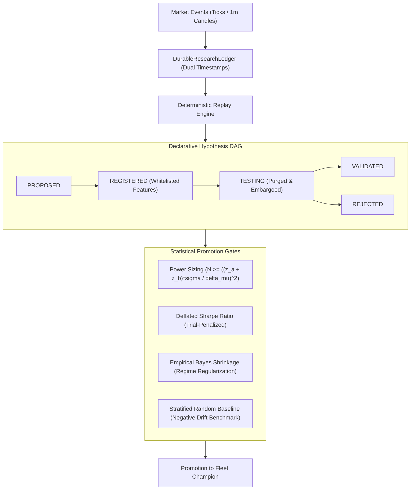

# Systematic Crypto Research & Validation Architecture

This document specifies the statistical foundations, data contracts, and verification protocols implemented in `crypto-trading-agent` to eliminate selection bias, lookahead leaks, and overfitting.

---

## 1. Architecture Overview



---

## 2. Pillar 1: Data Provenance & Timestamp Contract

To prevent lookahead and survival bias, market and execution records in `DurableResearchLedger` strictly enforce a three-timestamp contract:

1. **`exchange_time`**: The authoritative timestamp assigned by the exchange when the candle closed or the order fill matched.
2. **`received_at`**: The local monotonic wall-clock timestamp when the networking socket received the packet.
3. **`available_at`**: The earliest point in time when downstream features or indicator calculations could be computed without knowing future events.

### Invariant & Pure State Reconstruction
The ledger is strictly append-only with monotonically increasing `sequence_id`. Position state, cash balances, fee deductions, funding payments, and realized PnL are rebuilt deterministically via `reconstructState()`:

$$\text{Realized PnL} = \sum_{\text{exits}} (\text{fill\_price} - \text{entry\_price}) \times \text{qty} - \text{fees} - \text{funding}$$

---

## 3. Pillar 2: Stratified Random Baseline

A candidate strategy cannot merely show positive backtest returns; it must statistically outperform a randomized entry baseline operating under identical market conditions.

- **Seeded Generator**: Deterministic PRNG (`mulberry32`) ensures bit-for-bit replay reproduction.
- **Stratified Regimes**: Samples are stratified across 6 market regimes:
  `TREND_UP`, `TREND_DOWN`, `RANGE`, `HIGH_VOL`, `LOW_VOL`, `TRANSITION`.
- **Exit Bracket Protocol**: Every random entry operates with fixed brackets (e.g., $1.5\text{R}$ Take-Profit, $1.0\text{R}$ Stop-Loss, and time-based timeout).
- **Cost Benchmark**: Under dual-leg taker fees ($0.05\%$ entry $+ 0.05\%$ exit) and slippage ($0.02\%$), random entries exhibit an expected negative drift of approximately $-0.06\text{R}$ to $-0.10\text{R}$. A viable strategy must overcome this hurdle net of friction.

---

## 4. Pillar 3: Statistical Hardening & Acceptance Gates

### 4.1 Power-Calibrated Sample Sizing
Fixed arbitrary trade counts (e.g. $N=30$) are statistically invalid for detecting small edges. The required sample size is derived directly from statistical power ($1 - \beta = 0.80$) and significance ($\alpha = 0.05$):

$$N \ge \left( \frac{(z_\alpha + z_\beta) \cdot \sigma}{\Delta\mu} \right)^2$$

- For a large breakout edge ($\Delta\mu = 0.50\text{R}, \sigma = 1.0\text{R}$): $N \approx 32$ trades.
- For a subtle edge ($\Delta\mu = 0.10\text{R}, \sigma = 1.0\text{R}$): $N \approx 784$ independent trades.

The promotion gate enforces this in two layers:

1. **Explicit target** — when the policy states `targetEffectSizeR`, the power formula above derives the required $N$ from the *training split's* sigma (`powerSigmaR` overrides it); holdout data never tunes the requirement. The requirement is enforced on both the raw OOS trade count and the cluster-adjusted effective sample size, so clustered (same-day) observations cannot masquerade as independent evidence.
2. **Self-calibrating MDE guard** — after every hard floor passes, the gate computes the minimum detectable effect $\text{MDE} = (z_\alpha + z_\beta)\sigma / \sqrt{n}$ from the observed per-trade moments and returns `INSUFFICIENT_DATA` unless the observed mean edge clears it. Thirty trades at $\sigma = 1R$ can only confirm edges $\ge 0.51R$; a 0.05R edge on 30 trades is not evidence, and the gate now says so.

The static `minTrades` floor remains only as a fallback for callers without moment statistics.

### 4.2 Deflated Sharpe Ratio (DSR) & Probabilistic Sharpe (PSR)
When evaluating $N$ backtest trials, standard Sharpe ratios are severely inflated by selection bias. We apply Bailey & López de Prado's Deflated Sharpe Ratio:

$$\text{DSR} = \text{PSR}\left( \text{SR}^*, \text{SR} \right) = Z\left( \frac{(\text{SR} - \text{SR}^*) \sqrt{T-1}}{\sqrt{1 - \gamma_3 \text{SR} + \frac{\gamma_4 - 1}{4} \text{SR}^2}} \right)$$

where the benchmark expected maximum Sharpe under $N$ independent trials is:

$$\text{SR}^* = \sqrt{\mathbb{V}[\{\text{SR}_n\}]} \left( (1 - \gamma) Z^{-1}\left(1 - \frac{1}{N}\right) + \gamma Z^{-1}\left(1 - \frac{1}{N e}\right) \right)$$

Candidates with high trial counts and negative skewness ($\gamma_3$) or excess kurtosis ($\gamma_4$) are deflated accordingly.

**Input contract (enforced):** when `minDsr` is enabled, the DSR consumes an *actual fixed-frequency OOS portfolio equity-return series* (`ExperimentConfig.equityCurve` marks at a declared cadence, validated for exact boundary and gap-free coverage by `buildPeriodicEquityReturns`), plus an explicit cumulative `trialCount` and a measured `trialSharpeVariance` on the same cadence. Per-trade net R is a different statistic and is **never** substituted for account-level returns; missing equity or trial-history evidence returns `INSUFFICIENT_DATA`, never a promotion. Because the self-improvement loop consumes a setup-outcome ledger and does not own a portfolio equity curve, DSR is opt-in at policy level and fails closed when the required evidence is absent.

### 4.3 Null-Correct Bootstrap Inference
`Bootstrap.bootstrapMean` reports distinct quantities that are NOT interchangeable:

- `probPositive` — share of *uncentered* resampled means above zero. A data summary. Not a p-value, not $P(E[R]>0 \mid \text{data})$.
- `pValue` — one-sided p-value for $H_0: E[R] \le 0$ from a **null-centered cluster bootstrap**: every cluster's sum is shifted so the null holds exactly, clusters are resampled under the null, and the p-value is the tail at or beyond the observed mean. This is the quantity Holm correction operates on. Degenerate cases with no estimable null tail (a single independent cluster, or a null distribution with no spread) conservatively report $p = 1$.
- `pValueSignFlip` — cluster-level sign-flip randomization test of the same null (robustness check).

For promotion power sizing, `Bootstrap.effectiveSampleSize` estimates a conservative design effect from the intracluster correlation. Negative estimated ICC is not used to claim more independent observations. The cluster bootstrap remains the inferential procedure; effective N is a planning diagnostic the promotion gate applies to the power requirement.

Null simulations (`tests/bootstrapNull.test.ts`) verify the reported level on zero-edge data (false-positive rate near the 5% nominal), the power on genuine edges, monotonicity in edge strength, and robustness to skewed payoff distributions; `tests/statisticalHardening.test.ts` covers degenerate and single-cluster inference.

### 4.4 Research-Input Integrity (fail closed)
A configured filter that cannot be evaluated against recorded evidence invalidates the experiment — it is not a silent no-op. Today this guards `maxSpreadBps`: `SetupMap` captures the quote spread when the venue reports it and `SetupOutcomeLedger` persists it with the setup; if a spec configures a finite spread cap while relevant ledger rows lack a valid recorded spread, `ExperimentRunner` marks the run as an **incomplete research input** and the promotion gate returns `INSUFFICIENT_DATA` — missing legacy data is never silently treated as a pass. Separately, `contractViolations` on the result (a filter that could not be evaluated at all) causes a hard `REJECT`.

### 4.5 Empirical Bayes Shrinkage
To prevent small-sample overfitting across market regimes, raw regime expectancies $\hat{\mu}_c$ are shrunk toward the grand baseline mean $\hat{\mu}_b$:

$$\hat{\mu}_s = \frac{n}{n + k} \hat{\mu}_c + \frac{k}{n + k} \hat{\mu}_b$$

Where $k$ acts as a pseudo-count prior ($k=25$). Strata with few observations ($n < 10$) are pulled strongly toward the baseline, preventing false regime-specific claims.

### 4.6 Walk-Forward Purging & Embargo
Cross-validation folds enforce an explicit embargo window (default 5 days) between train and test splits to eliminate serial autocorrelation and multi-day volatility spillover.

### 4.7 Sortino Downside Deviation
`BacktestMetrics` computes downside deviation with MAR $= 0$ over the FULL sample $N$ (the Sortino & van der Roer convention), not over the count of negative observations — dividing by the downside count overstates downside risk and understates Sortino whenever wins are frequent.

---

## 5. Pillar 4: Declarative Hypothesis & LLM Anonymization

### 5.1 Whitelisted Feature Space
The `HypothesisRegistry` enforces a strict closed-world ontology (`WHITELISTED_FEATURES`):
`sweep_depth_atr`, `sweep_displacement_atr`, `absorption_score`, `order_flow_imbalance`, `spread_bps`, `break_distance_atr`, `reward_risk_ratio`, `atr_volatility_pct`, `funding_rate_apr`.
Any hypothesis referencing unmeasurable or hallucinated indicators is rejected at registration.

### 5.2 Ticker & Date Anonymization
To prevent LLMs from exploiting memorized historical market events (such as the March 2020 crash or November 2022 FTX collapse), all research prompts passed to `ResearchAgent` are masked via `anonymizeForResearch()`:
- Tickers are converted to neutral tokens (`ASSET_A`, `ASSET_B`).
- Timestamps and dates are mapped to relative time offsets (`PERIOD_0`, `PERIOD_1`).

---

## 7. Pillar 5: Quantitative Risk Analytics (research plane)

Four research-only modules quantify risk and sizing *consequences*; none of them feeds the live trading core,
and none of them can manufacture an edge. Promotion evidence still flows exclusively through the
statistics plane (Bootstrap + PromotionGate).

### 7.1 Monte Carlo Risk Simulation (`src/research/MonteCarlo.ts`, `npm run research:montecarlo`)

Seeded equity-path simulation over the ledger's cost-adjusted trade series under a fixed-fractional sizing
model (`equity *= 1 + f*R`). Resampling modes: `iid`, moving-`block` (default, preserves serial dependence),
and `regime` (block bootstrap stratified by historical regime frequency). Reports:

| Risk measure | Question answered |
| --- | --- |
| Max-drawdown distribution (median/p95/p99) | How large could a drawdown plausibly become? |
| P(breach kill-switch drawdown limit) ± binomial SE | How often would the strategy trip the kill switch? |
| P(ruin) ± SE | How often does equity hit the configured ruin floor? |
| Final equity/return percentiles | What range of outcomes do the paths produce? |
| Longest underwater stretch (median/p95) | How long could the account sit below its peak? |
| P(liquidation), event count | Under the assumed leverage, how often is the single-trade margin wiped? |

### 7.2 Kelly Sizing Analysis (`src/risk/KellySizer.ts`, `npm run research:kelly`)

Binary closed-form reference $f^* = (bp - q)/b$ plus the primary estimator: the fraction maximizing
$E[\log(1 + fR)]$ over the empirical net-R distribution (never recommending a fraction that any observed
trade would have ruined). The fraction is bootstrapped (cluster-aware) into a confidence interval and graded:
`INSUFFICIENT_DATA` (< 30 trades), `UNCERTAIN` (interval includes zero — the correct bet is zero), or
`POSITIVE_EDGE` (fractional-Kelly recommendations still preferred). Research-only: the live RiskEngine's
per-trade budget, portfolio caps and liquidation-distance checks remain authoritative.

### 7.3 Volatility Clustering (`src/research/VolatilityClustering.ts`, `npm run research:volclust`)

Ljung-Box ARCH-effect tests on squared and absolute returns (is there clustering at all?), followed by a
chronological out-of-sample horse race of one-step-ahead volatility forecasts (naive constant / rolling
window / EWMA / GARCH(1,1) grid quasi-MLE) scored by QLIKE. A more complex model is kept only when it beats
EWMA by more than the configured threshold out of sample — `sophisticatedModelEarnsItsComplexity` is the
verdict. Recommendation: `NO_CLUSTERING_CONSTANT_VOL_OK | CLUSTERING_USE_EWMA | CLUSTERING_USE_GARCH`.

### 7.4 Statistical Arbitrage (`src/research/StatArb.ts`, `npm run research:statarb`)

Engle-Granger cointegration (OLS hedge ratio + ADF on residuals with MacKinnon 1996 critical values),
spread half-life, and a chronological walk-forward pairs study: hedge ratio and spread statistics are
calibrated on a trailing window, trades happen on the following bars, every round trip is charged the
configured bps of gross notional. **The cointegration gate is on by default**: the z-score of a
non-stationary spread against its own rolling mean exhibits *artificial* mean reversion, and ungated
pairs studies manufacture spurious profits on pure random walks — the test suite pins this artifact so it
cannot be silently "fixed" away. Correlation is reported but never treated as a cointegration test.

---

## 8. Verification & Runbook

Execute the following test suites to verify system integrity:

```bash
# 1. Verify append-only research ledger and state reconstruction
npx tsx --test tests/researchLedger.test.ts

# 2. Verify bit-for-bit replay determinism and sensitivity
npx tsx --test tests/researchReplayIntegrity.test.ts

# 3. Verify stratified random baseline and bracket protocol
npx tsx --test tests/stratifiedBaseline.test.ts

# 4. Verify statistical hardening (shrinkage, power sizing, DSR)
npx tsx --test tests/statisticalHardening.test.ts

# 5. Verify declarative hypothesis registry and anonymization
npx tsx --test tests/hypothesisRegistry.test.ts

# 6. Verify promotion gate integrated rules
npx tsx --test tests/promotionGate.test.ts

# 7. Verify null-correct bootstrap inference (level + power simulations)
npx tsx --test tests/bootstrapNull.test.ts

# 8. Verify Monte Carlo risk simulation
npx tsx --test tests/monteCarlo.test.ts

# 9. Verify Kelly sizing analysis
npx tsx --test tests/kellySizer.test.ts

# 10. Verify volatility clustering diagnostics
npx tsx --test tests/volatilityClustering.test.ts

# 11. Verify statistical arbitrage pairs framework
npx tsx --test tests/statArb.test.ts

# 12. Run full test suite (1,790+ passing specs)
npm test
```

### Research CLIs added by Pillar 5

```bash
npm run research:montecarlo   # Monte Carlo risk paths over the setup-outcomes ledger
npm run research:kelly        # Kelly sizing analysis of the same trade series
npm run research:volclust     # volatility clustering diagnostics (--closes FILE | --synthetic)
npm run research:statarb      # cointegration pairs study (--a FILE --b FILE | --synthetic)
```

## 9. Evidence required for spread-filter and DSR experiments

SetupMap captures the quote spread from the market state's derivatives snapshot when available, and SetupOutcomeLedger persists that value with the setup. maxSpreadBps now applies as an actual filter. If a finite spread threshold is part of a candidate but relevant ledger rows lack a valid recorded spread, ExperimentRunner marks the run as incomplete and PromotionGate returns INSUFFICIENT_DATA; missing legacy data is not silently treated as a pass.

DSR inputs are deliberately separate from the setup-outcome ledger. The experiment runner accepts `equityCurve` marks with a `frequencyMs` cadence; the curve must cover the exact test interval at the declared cadence with no missing or invalid marks. A setup-level R series is not substituted for account-equity returns. The current self-improvement loop does not itself own an equity curve, so DSR remains inactive unless a caller supplies the required equity and trial-history evidence and enables minDsr.
