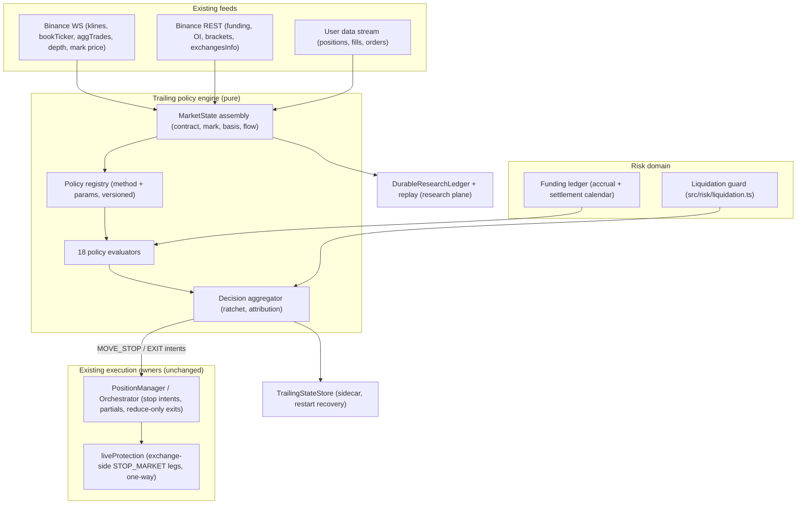

# Crypto futures trailing policy engine — implementation specification

**Status:** proposed 2026-11-03. **Depends on:** `src/position/PositionManager.ts` (stop-intent executor), `src/risk/liquidation.ts`, `src/agents/TrailingStopManager.ts`, the microstructure feed (`src/microstructure/`), and the research plane (`DurableResearchLedger`, `ReplayEngine`, `PromotionGate`, the ablation framework). **Scope:** a versioned trailing **policy evaluation engine** for Binance USDⓈ-M perpetual futures with 18 method modules, a deterministic state machine, liquidation/funding guards, and a historical paired-replay validation plan. Nothing in this spec enables a live entry, changes the RiskEngine limits, or bypasses the single order path.

**Operating boundary (unchanged):** the environment is paper/research-only. Zero validated strategies, zero authorized live entries. The trailing engine adds no entry path — it only manages exits for positions an approved path already opened, and returns `NO_POLICY_CHANGE` otherwise. Live promotion is out of scope; §14 defines the promotion ladder that stops at paper.

---

## 1. The question this answers

The current trailing stack is two hardcoded policies:

- `src/agents/TrailingStopManager.ts` — profit tiers (BE at 1R, +0.5R/+1R/+2R at 1.5R/2R/3R) plus a Chandelier-style `extreme − 1.5·ATR` pull-in and SuperTrend stop adoption.
- `src/position/PositionManager.ts` — TP1/TP2 partials, breakeven + cost buffer, an ATR chandelier trail from the entry-side extreme, and structure stops (swing, SuperTrend).

Both encode one opinion about how to trail. The claim to be tested: **the best trailing method for SOLUSDT in a strong trend is not the best method in a range, a funding distortion, or a liquidity sweep.** The engine must let historical replay discover which policy wins in which context — using identical entries, identical initial risk, and identical costs — instead of shipping one method for every context and calling it a design.

## 2. Decisions

1. **One shared engine, 18 policy modules, one ratchet.** All methods emit candidate stops in directional coordinates; a single aggregator applies the monotonic ratchet (§3, I1). No method touches Binance; the orchestrator's existing order path remains the only executor (mirrors the audit doctrine already applied to strategies).
2. **Reuse repo types, not a parallel ontology.** `Side` from `src/types.ts` is the direction type; liquidation math comes from `src/risk/liquidation.ts` (`isolatedLiquidationPrice`, `stopClearsLiquidation`); funding accrual plugs into the 8h-boundary funding push that the paper engine and broker already perform; the persisted-state sidecar follows `PositionManagerStore` (atomic tmp+rename, material-change flush, venue-rebuild fallback).
3. **Four reference prices, three trigger references.** Contract price (indicators + fills), mark price (risk monitoring and `workingType=MARK_PRICE` conditional triggers only — never a fill price), index price (context only, not a trigger: Binance USDⓈ-M conditional orders support `CONTRACT_PRICE`/`MARK_PRICE` working types), bid/ask (execution realism). Every `EXIT` decision records **which reference triggered** it; the fill still executes against the contract order book.
4. **Funding is an accounting term, not a trailing rule.** Signed cash flow `−s·Notional·rate` at each settlement; exits just before a settlement are a *tested hypothesis* (`FUNDING_TIMING` experiment), never an automatic rule. No theta analogue exists in perpetual futures; time-decay trailing (method 13) controls exposure of unrealized profit, not decay.
5. **Leverage does not multiply P&L.** Notional P&L is `Q·s(P−E)` regardless of leverage; leverage changes margin, liquidation proximity, and return on margin. The engine reads `Position.leverage` and `liquidationPrice` — it never resizes (I10: no trailing action may increase position size).
6. **Existing limits stay.** Research risk remains 0.25–0.5%/trade, 1.5–2% daily loss cap, 3x baseline leverage, no averaging down, no pyramiding. Stop distance still determines quantity (`Q = RiskBudget / (stopDistance + costAllowance)`), respecting lot/min-notional/bracket via the existing `symbolRules` + `RiskEngine`; the trailing engine only tightens.
7. **One-way mode is the supported position mode.** Hedge mode is refused by the live path today (`docs/superpowers/specs/2026-09-22-coindcx-live-execution-design.md`, README modes table); hedge stays refused for entries, and the policy config records `positionMode` for forward compatibility. `reduceOnly` is never sent in hedge mode and `closePosition` semantics are one-way-only today — the order adapter validates the collision matrix in §9.3.
8. **Native `TRAILING_STOP_MARKET` is an execution adapter, not a policy.** It is a fixed `(activationPrice, callbackRate)` trailing percentage — none of the 18 methods except method 11's flat cases reduce to it. Phase 7 may use it as a *backstop* policy in shadow mode; replay never counts a native order it cannot simulate deterministically.
9. **Validation reuses the research machinery.** Chronological day-floored splits with purge/embargo, day-clustered (paired) bootstrap, Wilcoxon, Holm family correction across the whole tested method set, DSR only where an equity curve exists, cost curves at 0.5×–3× fees+slippage, delayed-entry controls, and promotion through `PromotionGate`. Methods run on **identical entries and identical initial risk** — the paired protocol of §13.
10. **The default stays unchanged.** Until a method beats `DEFAULT_PM_CONFIG`-managed control on evidence, the fleet keeps the current manager. The engine ships with all policies `enabled: false` and shadow-recording on.

## 3. Common mathematical model

Direction `s ∈ {+1, −1}` (`Side` LONG/SHORT). Working variables per open position:

- `E` — average entry price (`Position.entry`); `P_t` — contract price; `ATR_t` — contract ATR (assigned per policy); `Q` — open quantity; `H_t`, `L_t` — highest/lowest contract price since entry; `M_t` — mark price.

Directional coordinate `X_t = s·P_t`; favourable extreme `F_t = max_{u≤t} X_u` (equals `H_t` for longs, `−L_t` for shorts); stop in directional coordinates `Z_t = s·SL_t`, so:

- candidate → ratchet: `Z_t = max(Z_{t−1}, CandidateStop_t)` — one `tighter()` from the existing managers, applied in `Z` space;
- exit: `X_t ≤ Z_t` (in `SL` space: long `P ≤ SL`, short `P ≥ SL`).

**I1 (non-negotiable ratchet).** LONG stops only move up; SHORT stops only move down. A volatility expansion, regime change, or policy switch can never loosen an existing stop. A switch to a *looser* method only takes effect on the next position.

**Initial risk.** `D0 = |E − SL₀|`; `R0 = Q·D0 + EstimatedCosts` where `EstimatedCosts` = round-trip taker fees + slippage buffer + expected funding for the max planned hold. `Position.initialRisk` carries `D0` (price units) as today; `R0` is derived, not redefined.

**P&L.** Gross `= Q·s(P_t − E)`. Funding accrues per settlement as `−s·Q·E_i·rate_i` on mark-anchored notional. Net `= Gross − fees − funding − slippage`. The giveback/R-staircase methods key off **net**, so the engine maintains `fundingAccrued` from settlement events, not from the mark's snapshot P&L.

**Stop-vs-quantity order.** The engine never *sets* quantity; quantity was fixed by the risk budget before entry. The engine widens protection only in the impossible case (the stop would breach liquidation clearance), and its remedy is `EXIT_PENDING` protective close, not resize.

## 4. Architecture



Boundary rule: the engine **calculates**; `PositionManager`/`Orchestrator` **act** (stop moves, partials, reduce-only market exits); `liveProtection` mirrors protective stops exchange-side as it does today. Decision epochs are the existing manage pass (tick-driven); in replay they are the replay clock.

## 5. TypeScript contracts

All in `src/trailing/types.ts` (file ≤ 300 lines; split imports if needed). References repo types: `Side`, `Position`, `Mode`, `AgentId`.

```ts
import type { Position, Side, AgentId } from '../types.js';

/** Which published price produced a trigger. INDEX_PRICE is context-only (no venue trigger type). */
export type PriceReference = 'CONTRACT_PRICE' | 'MARK_PRICE' | 'INDEX_PRICE';
export type PriceDomain = 'CONTRACT' | 'MARK';

export type MethodId =
  | 'ATR_TRAIL' | 'CHANDELIER' | 'SUPERTREND' | 'PSAR' | 'MA_TRAIL' | 'ALMA_HMA'
  | 'SWING' | 'FRACTAL' | 'BOS_CHOCH' | 'DONCHIAN'
  | 'R_STAIRCASE' | 'GIVEBACK' | 'TIME_DECAY'
  | 'MARK_ATR' | 'MARK_CHANDELIER' | 'CONTRACT_MARK_HYBRID'
  | 'ORDER_FLOW' | 'REGIME_ADAPTIVE';

/** Layer 1 price protection, layer 2 profit protection, layer 3 context/microstructure. */
export type MethodLayer = 'PRICE' | 'PROFIT' | 'CONTEXT';

/** Priority P0 = phases 1–2, P1 = phase 3, P2 = phase 6 (order flow + collector). */
export type MethodPriority = 'P0' | 'P1' | 'P2';

export type PolicyDomain = 'CONTRACT' | 'MARK' | 'PROFIT' | 'ORDER_FLOW' | 'HYBRID';

export interface PolicyActivation {
  /** Gate controlling when a policy may first emit candidates; NEVER = registered but inactive. */
  type: 'IMMEDIATE' | 'MFE_R' | 'PEAK_PNL' | 'TP1_FILLED' | 'NEVER';
  /** Threshold in the activation's unit (R multiples, USDT, or unused). */
  threshold: number;
}

export interface TrailingPolicy {
  id: string;                          // policy instance, e.g. 'C01-atr14-k2-R-stair'
  version: string;                     // schema version of this policy definition
  method: MethodId;
  layer: MethodLayer;
  priority: MethodPriority;
  domain: PolicyDomain;
  params: Record<string, number | readonly number[]>;  // validated per method (§6)
  activation: PolicyActivation;
  priceReference: PriceReference;      // where its trigger is measured
  /** Tightening-only overrides (order flow): multiplier range [0.5, 1.0] applied to the
   *  active stop distance; null = not applicable. */
  tightenOnly?: { minMultiplier: number; maxMultiplier: number };
  enabled: boolean;
}

export interface PolicyContext {
  position: Position;                  // repo Position (entry, qty, mark, leverage, liquidationPrice…)
  s: 1 | -1;                           // derived from side
  contract: { price: number; high: number; low: number; close: number; ts: number };
  mark: { price: number; high: number; low: number; fundingRate: number; nextFundingAt: number };
  index: { price: number } | null;
  book: { bid: number; ask: number; bidDepthUsdt: number; askDepthUsdt: number; seq: number; stale: boolean } | null;
  flow: { cvdWindowSize: number; obi: number; aggressiveBuyUsdt: number; aggressiveSellUsdt: number } | null;
  atr: { contract: number | null; mark: number | null };
  candles: { tf: string; o: number; h: number; l: number; c: number }[];  // per policy timeframe
  extremes: { favorableExtremeX: number; peakNetPnl: number | null };     // persisted in TrailingState
  account: { fundingAccrued: number; feesAccrued: number; entryFees: number; fundingSettledAt: number[] };
  regime: { volClass: 'LOW' | 'MEDIUM' | 'HIGH'; trendScore: number | null; oiDelta: number | null };
}

/** Candidate emitted by one policy evaluation. levelZ is in DIRECTIONAL coordinates: */
/**   X = s·price; candidate valid iff candidateX > current stopZ. */
export interface StopCandidate {
  policyId: string;
  levelZ: number;                       // stop in directional coordinates
  priceReference: PriceReference;
  reason: string;                       // e.g. 'chan-3.0atr-mark', 'swing-confirmed-low'
  ttlBars?: number;                     // structural candidates expire if unconfirmed within n bars
}

export type TrailingAction = 'HOLD' | 'MOVE_STOP' | 'EXIT' | 'TIGHTEN';

export interface TrailingDecision {
  positionId: string;
  policyIds: string[];                  // every policy that ran this pass
  action: TrailingAction;
  stopPrice?: number;                   // contract-price stop to place (post-ratchet)
  stopZ?: number;
  /** For EXIT / triggered MOVE_STOP: which reference breached first (I3 attribution). */
  triggerReference?: PriceReference;
  triggerDomain?: PolicyDomain;
  reasonCode: string;                   // e.g. 'CHANDELIER_BREACH', 'GIVEBACK_EXCEEDED', 'LIQ_GUARD'
  evidence: Record<string, unknown>;    // numbers, never strings-parsed-later
  ts: number;                           // decision epoch (replay clock or exchange ts)
}

export interface TrailingState {
  key: string;                          // `${symbol}:${strategy}` as in PositionManagerStore
  symbol: string;
  strategy: AgentId;
  side: Side;
  entry: number;
  initialQty: number;
  reducedQty: number;
  phase: TrailingPhase;
  policyId: string;
  stopZ: number;                        // current ratcheted stop in directional coords
  confirmedStop: number;                // last stop ACKED by the venue/executor
  favorableExtremeX: number;            // max X since entry (never reset except on replace)
  peakNetPnl: number | null;            // method 12 domain
  mfeX: number; maeX: number;           // running MFE/MAE in X units for research
  fundingAccrued: number;
  feesAccrued: number;
  liquidationPrice: number | null;      // last computed/reported liq price
  openedAt: number; updatedAt: number;
  lastBookSeq: number | null;           // stale-book detection for ORDER_FLOW gating
  lastAcceptedDecision: { ts: number; stopZ: number; policyId: string } | null;
}

export type TrailingPhase =
  | 'INITIALIZING' | 'PROTECTED' | 'TRAILING_PENDING' | 'TRAILING_ACTIVE'
  | 'EXIT_PENDING' | 'EXIT_SUBMITTED' | 'PARTIAL' | 'CLOSED' | 'REJECTED' | 'RECONCILIATION';
```

Engine outputs a `TrailingDecision` per position per pass; the orchestrator maps `MOVE_STOP` onto the existing stop-intent path and `EXIT` onto a reduce-only market close (the current breach handling), sidecar-persisting like `PositionManagerStore`.

## 6. Method catalogue — 18 configurations

Defaults below are the **P0 research grids**; each entry names its trigger reference and the structural contract that makes it testable. Every method: pure, state isolable, candidate expressed in X coordinates, subject to I1. Unless stated, `ATR` is Wilder's on contract closes of the policy timeframe.

| # | Method | Pri | Domain | Reference | Defaults / grid |
|---|--------|-----|--------|-----------|-----------------|
| 1 | ATR trail | P0 | CONTRACT | CONTRACT_PRICE | period {7,14,21} × k {1.5,2,2.5,3} × tf {5m,15m,1h}; candidate `Z = F − k·ATR` |
| 2 | Chandelier | P0 | CONTRACT | CONTRACT_PRICE | n 22, k 3 (grid k {2,2.5,3,3.5}, n {14,22,55}); `Z = F − k·ATR(n)` |
| 3 | Supertrend | P0 | CONTRACT | CONTRACT_PRICE | period 10, k 3 (grid period {7,10,21}, k {2,3,4}); final-band recurrence; band = candidate, flip = EXIT candidate |
| 4 | Parabolic SAR | P1 | CONTRACT | CONTRACT_PRICE | af0 0.02, step 0.02, max 0.2 (grid each ±doubling); reversal = EXIT on EP cross |
| 5 | EMA/SMA | P1 | CONTRACT | CONTRACT_PRICE | {9,20,50,100} on close; cross against position on confirming close → EXIT candidate |
| 6 | ALMA/HMA | P1 | CONTRACT | CONTRACT_PRICE | ALMA {9,21} offset 0.85 σ 6; HMA {16,21,34}; same cross semantics as #5 |
| 7 | Swing H/L | P0 | CONTRACT | CONTRACT_PRICE | pivot: 3 left + 2 right closing-basis; buffer `max(0.1×ATR, 2 ticks)`; only confirmed pivots update (no repainting) |
| 8 | Fractal | P1 | CONTRACT | CONTRACT_PRICE | 5-bar Williams; confirmation delay 2 bars included in replay; buffer as #7 |
| 9 | BOS/CHoCH | P0 | CONTRACT | CONTRACT_PRICE | deterministic swing series (§6 structure definitions); stop below protected HL / above protected LH minus buffer; CHoCH = confirming close through protected level → EXIT |
| 10 | Donchian | P1 | CONTRACT | CONTRACT_PRICE | exit channel {10,20,22,55}; EXIT only on confirming close through the opposite band |
| 11 | R staircase | P0 | PROFIT | CONTRACT_PRICE | milestones (R→locked X): 0.5→initial, 1→BE* , 1.5→+0.5R, 2→+1R, 3→+2R, 4→+3R; *BE = entry ± costBufferRate from `DEFAULT_PM_CONFIG` (2×(taker+slip)), grid ±tier steps |
| 12 | Giveback | P0 | PROFIT | CONTRACT_PRICE | arm at peak ≥ minArmPnl (default 1R); protected = peak − max(G_min, g·peak); g {0.1..0.5} × G_min forms ({0.2R, 0.5R} × peak); peak on **net** P&L (funding+fees included) |
| 13 | Time decay | P1 | PROFIT | CONTRACT_PRICE | k(t) = k_min + (k_max−k_min)·e^(−λt); k_min {0.5,1}, k_max {2,3}, half-life {4h,12h,24h}; reduces exposed-profit distance only; funding windows are a separate input, never folded in |
| 14 | Mark ATR | P0 | MARK | MARK_PRICE | ATR built from mark klines (`markPriceKlines` 5m/15m/1h); same shape as #1 on mark extremes; fair-value reference only, not executable |
| 15 | Mark Chandelier | P0 | MARK | MARK_PRICE | n 22, k 3 on mark bars; independent envelope; research question: fewer false exits on isolated contract wicks without raising execution risk |
| 16 | Contract+Mark hybrid | P0 | HYBRID | both | two independent envelopes; EXIT when either breached; attribution names the reference that crossed first (I3) |
| 17 | Order flow | P2 | ORDER_FLOW | CONTRACT_PRICE | OBI (depth ±0.1% band), CVD(5m) z-score, depth-collapse ratio, liq-event feed when verifiable; multiplier ∈ [0.5,1] on active stop distance; **tighten-only**, must never loosen (I11); disables on stale book/seq gap |
| 18 | Regime-adaptive | P0 research | HYBRID | per selected policy | selector over features already whitelisted (`atr_volatility_pct`, `funding_rate_apr`, `order_flow_imbalance`, `spread_bps`, …); mapping table is a **learned artifact** replay must produce (§13.4), never hardcoded; selector is itself a hypothesis evaluated alone vs the single best fixed method |

Deterministic structure definitions (methods 7/8/9). The repo's existing pivot detector (`isSwingHigh`/`isSwingLow` in `src/market/SweepLedger.ts`) uses a symmetric `strength`-sided high/low window confirmed `strength` bars later — by construction it can never repaint a pivot it already confirmed. The trailing engine adopts the same confirmation contract on closed bars: a swing low at bar `i` is confirmed at bar `i + n_right` iff `close[i]` is the strict minimum of closes over `[i − n_left, i + n_right]` (method 7 default: 3 left + 2 right, closing basis; SweepLedger `strength` defaults for policies experimentally aligned with sweep pools). Confirmed swings are append-only and never recomputed with hindsight (the no-repaint test in §12 mutates later candles and must observe no change). BOS up = confirming close above the latest confirmed swing high; CHoCH = the first structure-breaking close against the current protective impulse. All bars-only: no intrabar pivot membership before bar close.

## 7. Config and policy registry

`src/trailing/registry.ts` — versioned config schema; fingerprinted canonical JSON (sha256) like `src/research/ablation/fingerprint.ts`. First wave combos:

| Policy id | Composition |
|-----------|-------------|
| C01 | ATR(14,k2) + R staircase |
| C02 | Chandelier(22,3) + Giveback(g 0.3) |
| C03 | Swing + Giveback |
| C04 | BOS/CHoCH + R staircase |
| C05 | Supertrend(10,3) + ATR(21,k2.5) floor |
| C06 | Contract Chandelier + Mark ATR (hybrid 16) |
| C07 | Swing + Order-flow tightening (P2, shadow-only until feed validated) |
| C08 | Regime-adaptive selector over {C01..C05} |

Registry semantics: policies are **ordered layers** (price protection base, profit protection over it, context tightenings on top); the aggregator intersects candidate sets — layers are additive constraints, not alternates (an EXIT candidate from any layer wins; a TIGHTEN from layer 3 applies to whatever layer 1/2 hold). Validation: unknown method id, params outside the grid listed in §6, or a policy whose `domain` disagrees with its method → registry refuse-at-load. Every change to any param is a new policy version; evidence (§13) attaches to the version, never floats.

## 8. Deterministic state machine

Per position. Transitions are events + guards, applied only in the manage pass; every transition persists material state immediately (crash-safe).

| State | Meaning | Exits to | Transition guard |
|-------|---------|----------|------------------|
| INITIALIZING | position known, SL₀ persisted, indicators not warm | PROTECTED, RECONCILIATION | SL₀ confirmed on venue / initial R recorded |
| PROTECTED | only initial/structural protection live; policies not armed (activation unmet) | TRAILING_PENDING, EXIT_PENDING, RECONCILIATION | activation reached (MFE_R / peak / TP1) |
| TRAILING_PENDING | first ratchet candidate produced; intent not yet ACKed | TRAILING_ACTIVE, PARTIAL, REJECTED | executor ACKs stop move |
| TRAILING_ACTIVE | ratcheting on every pass; candidates pending or accepted | EXIT_PENDING, RECONCILIATION | breach on trigger reference |
| EXIT_PENDING | policy breach persisted as durable exit intent, not yet sent | EXIT_SUBMITTED, PARTIAL | order accepted by executor |
| EXIT_SUBMITTED | reduce-only exit in flight | PARTIAL, CLOSED, RECONCILIATION | partial fill / full fill / unknown outcome |
| PARTIAL | fill reduced quantity; remaining stop resynced to filled Q | TRAILING_ACTIVE, EXIT_PENDING | remaining quantity managed |
| CLOSED | position flat; state archived to research ledger | (terminal) | — |
| REJECTED | venue refused a stop update | RECONCILIATION | reconciliation resolves |
| RECONCILIATION | venue state ≠ engine state (restart, desync, unknown outcome) | any state except CLOSED, or CLOSED | verified against venue positions/fills |

Determinism rules:

- **Dedup (I6).** One event id `(positionId, passTs, policyId)`; a duplicate market event cannot re-trigger an already-persisted transition (EXIT_PENDING is idempotent).
- **Restart recovery.** On load: validate `TrailingState` shape (like `PositionManagerStore.isStateMap`); `favorableExtremeX = max(persisted, s·currentMark)` — the peak never regresses; `stopZ = confirmedStop` wins over any unsent candidate; phase re-derived from venue position and confirmed protective order. Missing state rebuilds as INITIALIZING only when a numeric SL₀ exists; positions without a stop are reported to the unprotected-position detector, not silently adopted (matching `src/risk/unprotected.ts` doctrine).
- **Staleness.** Mark/book data older than `maxDataAgeMs` (default 5 s paper, 1 s replay-with-ticks) blocks TIGHTEN and steepens nothing; `ORDER_FLOW` policy hard-disables on stale book or sequence gap (I11, reusing `LocalOrderBook` seq contract).
- **No self-loosening tip-over.** If a *policy switch* produces a looser stop, the ratchet rejects it and the state records `rejectedLoosening` evidence for research (never for live drift).

## 9. Account-risk domain

### 9.1 Liquidation guard (hard precedence over every policy)

- Recompute per pass: `isolatedLiquidationPrice(...)` from `src/risk/liquidation.ts` using venue brackets when connected, `REPLAY_MAINTENANCE_TIERS` in replay (documented conservative holdover), `Position.liquidationPrice` cross-check when the venue reports one (prefer venue value; engine value labelled `isLiqEstimated`).
- Acceptance: `stopClearsLiquidation(side, stop, liq, clearance)` with `clearance = max(clearanceAtr·ATR_mark, minClearanceTicks)`; `clearanceAtr` comes from the existing risk config (`config.risk.minLiqBufferAtr`, `MIN_LIQ_BUFFER_ATR`, default 1 ATR under `src/config.ts`), so a stop sitting inside clearance is refused (candidate REJECT → HOLD).
- **Precedence I8:** if the *current confirmed* stop fails clearance (margin change, funding accrual, add of cum maintenance), the engine emits `EXIT_PENDING` with reason `LIQ_GUARD` — protective close before liquidation proximity, computed **independently of any trailing policy**. Liquidation is never an acceptable substitute for a stop.

### 9.2 Funding ledger

- Accrual at each 8h UTC settlement (per repo cadence): `fundingAccrued += −s·Q·markAnchor·rate`; fees tracked separately; `peakNetPnl` and r-tiers consume funding-inclusive net only.
- `fundingStress` input = |rate| z-score vs the symbol's own trailing window (existing pattern in `docs/research-log.md`), feeding `REGIME_ADAPTIVE` context `funding_distortion` — a tightening/monitoring context, **not** an exit rule. Exits before a settlement vs through it are the `FUNDING_TIMING` experiment (§13.5); no automatic close.

### 9.3 Position/margin mode matrix

| Position mode | Margin | Engine behavior |
|---------------|--------|-----------------|
| ONE_WAY | ISOLATED | supported: guard, trailing, closePosition-style reduce-only close |
| ONE_WAY | CROSS | supported with per-position liq = engine estimate flagged; clearance widened by a spec constant (proposed 25%, validated in replay first) — cross liquidation is account-level |
| HEDGE | either | entries refused today (repo guard); engine **refuses to manage a hedge-mode position** unless a future spec ports the entry guard and positionSide semantics; logged, not adopted |

Order-payload collision rules (§2.7) are validated by the execution adapter, not recreated: `reduceOnly` only in one-way; `positionSide` required in hedge; `workingType ∈ {CONTRACT_PRICE, MARK_PRICE}` per `PriceReference`.

## 10. Native Binance trailing adapter (P2, adapter only)

`src/trailing/nativeAdapter.ts` maps a validated policy decision to a `TRAILING_STOP_MARKET` backstop:

- Long: SELL trailing, `activationPrice`, `callbackRate` (0.1–5, %, venue range), `workingType` per policy reference; short mirrored.
- Use is confined to Phase 7 shadow/paper: it may **only be tighter** than the engine stop, never replaces policy trailing, and is disabled when the policy produces structural (level-based) stops whose translation loses more than one tick.
- Replay never claims native-order fills: deterministic fill model belongs to the engine + execution simulator, following `src/backtesting/PerpetualExecutionEngine.ts` conventions (stop tested before target within a bar, taker fee + slippage on both legs).

## 11. Execution and cost model

Shared constants with the repo (single source of truth, not redefined): taker fee rate, slippage buffer rate (`DEFAULT_PM_CONFIG.costBufferRate = 2×(0.0004+0.0002)`), research cost benchmark 0.05%/leg + 0.02% slip (`RESEARCH_SYSTEM` §3). Cost curve sweeps both settings plus extremes at 0.5×–3× per §13.

- Fill realism: exits fill at `min(bid, stop)` long / `max(ask, stop)` short with an applied slip buffer; gap-through fills at the open of the gap bar (no mark-price fills, ever).
- Partial fills: reduce engine state by filled Q; remaining-stop resync keeps levels (levels are per-price, invariant to Q), re-derives R accounting on the remaining notional.
- Latency: replay models the existing 'decision at close, action next bar/tick' convention of the replay engine; the engine is not allowed to trade on the bar forming.

## 12. Test plan

Unit (`npx tsx --test tests/<file>` + `npx tsc --noEmit`; node:test, snapshot-free, pure-function tests like the position suite):

| Test file | Required cases |
|-----------|----------------|
| `tests/trailingEngine.test.ts` | long/short symmetry in X coordinates; ratchet never loosens (incl. policy switch, vol expansion); activation gates; dedup of repeated passes; decision evidence completeness |
| `tests/trailingPriceMethods.test.ts` | ATR warmup + long/short symmetry; Chandelier directional extrema under ATR expansion; Supertrend final-band recurrence + flip produces EXIT; PSAR AF/EP/reversal |
| `tests/trailingAverages.test.ts` | EMA/SMA/ALMA/HMA values (goldens from closed-form), cross → EXIT, warmup |
| `tests/trailingStructure.test.ts` | swing confirmation with n_right delay (no repainting: mutating later candles must not change past confirmed pivots); fractal delay; BOS/CHoCH on deterministic fixture; Donchian rolling window |
| `tests/trailingProfit.test.ts` | R staircase milestones incl. cost-aware BE; giveback on peak net PnL (funding applied mid-peak resets the peak basis); time-decay k(t) monotonicity |
| `tests/trailingMark.test.ts` | mark ATR/Chandelier from mark bars; mark staleness blocks candidates; hybrid attribution records the breaching reference; mark gap cannot fabricate a fill (I3) |
| `tests/trailingOrderFlow.test.ts` | tighten-only multiplier range; seq-gap/stale disables; OBI/CVD inputs sanity (bad inputs → no-op, never a violation) |
| `tests/trailingSelection.test.ts` | regime → policy table loaded from evidence file; all-policies-disabled default; NO_POLICY_CHANGE when table misses registry |
| `tests/trailingStateMachine.test.ts` | every transition in the §8 table; restart recovery (extreme monotone union, confirmedStop wins); RECONCILIATION re-derivation from venue record; dedup per decision id |
| `tests/trailingRiskGuard.test.ts` | clearance math vs `isolatedLiquidationPrice`; REFUSED candidate; LIQ_GUARD precedence; funding accrual ledger; cross widening |
| `tests/trailingIntegration.test.ts` | the 12 invariants I1–I12 below |

Integration invariants (each one test):

1. **I1** LONG stop only up / SHORT only down — across all 18 methods.
2. **I2** restart → exact state restore (stop, peak, funding, seq).
3. **I3** mark-portfolio divergence cannot create a figurative fill: EXIT from a MARK reference records `triggerReference='MARK_PRICE'` and the executed fill derives from contract book data only.
4. **I4** funding accounted on signed cash flows along a long and a short through 3 settlements.
5. **I5** partial fill reduces remaining Q without moving levels; state resyncs.
6. **I6** duplicate market events cannot compound exits (idempotent EXIT_PENDING).
7. **I7** restart mid-flight (between decision and ack) → RECONCILIATION, then re-derivation.
8. **I8** liquidation guard takes precedence over every policy including regime changes.
9. **I9** position-mode matrix: hedge-mode position refuses management with a log; one-way payload collisions validated by the adapter.
10. **I10** no trailing action increases position size or emits a non-reduce-only order.
11. **I11** stale book / seq gap disables ORDER_FLOW without breaking other policies.
12. **I12** an exchange-declined stop move triggers reconciliation, and a stop the venue refuses results in protective close (live rule equivalent in paper/remoted broker path).

## 13. Historical experiment plan

### 13.1 Data plan (available vs to-build)

| Data | Status |
|------|--------|
| 1m/5m/15m/1h/4h klines | archive exists (`archiveKlines`, `data/market`) |
| funding history + rate stream | REST per symbol; collector trivial |
| mark klines (markPriceKlines) | REST-easy; add to the archive namespace of trailing research |
| index ticks | from mark-price REST bundle; store same cadence |
| aggTrades / depth | REST aggTrade window-limited (documented); **durable collector required** for the P2 window: record streaming deltas during target periods, else method-17 confidence is degraded |
| OI snapshots | REST poll at 5m into the same cycle |
| fills/user events | replay handles via synth execution model |

### 13.2 Paired protocol (same entries, same initial risk)

Evidence basis identical to the ablation framework: one causal pass per symbol-window composing an **entry set** (replayed strategy signals + stratified random bracket entries from the baseline pillar for volume), then a post-pass that — for each trade record — re-resolves the *same entry, same Q, same SL₀* under each policy in §7. Outputs per (policy, trade): `net R`, `MAE`, `MFE`, `givebackR`, `holdTime`, `fundingShareR`, `stopOuts`, `whipsaws` (distance-to-stop-touch without material adverse excursion), and **captureRatio** = netR / MFE_R.

Pairwise statistics on `(policy − control)` per trade, cluster-grounded (same-day clusters): paired bootstrap mean + CI, Wilcoxon signed-rank, both Holm-corrected across the full method family (including rejected policies — the whole grid is the family). Walk-forward: day-floored 50/25/25 splits, 5-day purge+embargo; DSR applied where an account-level equity curve can be assembled; power sizing (`SampleSize`) applies before any 'did better' claim: e.g. a subtle 0.1R delta needs hundreds of independent trades — the gate states this, it does not approve on N=30.

### 13.3 Experiment timeline (P0 first)

1. **S1 Machinery validation:** synthetic fixtures; no result claims; ledger, replay-clock, method determinism.
2. **S2 Fixed method grid:** #1 #2 #7 #9 #11 #12 #14 #15 #16 on 5m/1h, symbols `SOLUSDT/ETHUSDT/XRPUSDT`, 180 days, both directions; control = current `DEFAULT_PM_CONFIG` manager.
3. **S3 Combos C01–C05 (price/profit layering) as hypotheses** on train/val only; holdout read once past Holm+power gates.
4. **S4 Funding distortion + LH/HH context features; P1 additions (#3 #4 #5 #6 #8 #10 #13) on the same entries.**
5. **S5 C06 hybrid attribution study** (mark VS I3 wick rates) and C08 feasibility check (are contexts separated?).
6. **S6 ORDER_FLOW (C07) once the collector covers ≥ 60 days**, else marked `INSUFFICIENT_DATA` by evidence-faithfulness rules.
7. **S7 Cost stress, long/short symmetry, regime slices; negative controls (mirror/RNG exits, delayed entries).**

### 13.4 Regime-adaptive selector artifact

The selector is **learned late**: S2–S5 emit a context → best-policy table with per-cell expectancy CIs; a context stays `UNRECOMMENDED` (falls through to the existing default) unless the cell beats the overall best + the default with sufficient evidence. The shipped table is a committed file (`data/trailing/selection-v1.json`) reviewed against its CI table — never an inline `if(volatile) use X` in code.

### 13.5 What counts as 'validated'

Same ladder as the repo: experiment registry entry → PromotionGate (Holm family + day-clustered bootstrap lower bound + power/MDE + cost curve + delayed entries) → `VALIDATED` for paper placement → shadow recording → paper-only adoption. **No phase in this plan promotes a policy to live trading**, and the current research risk limits remain the binding constraints (§2.6).

## 14. Promotion ladder and paper deployment

1. `SHADOW` — engine runs, records decisions+counterfactual fills beside the default manager (position semantics unchanged).
2. `PAPER_VALIDATE` — replay evidence per §13 attaches to policy versions.
3. `PAPER_ACTIVE` — a validated policy manages paper positions (per-symbol opt-in file, default off).
4. **Live: not available at any phase of this spec.** Live adoption requires a separate operator-approved spec with its own guard criteria (reuse `strategyApprovals` + admission calibration). The decision engine's `NO_TRADE` boundary is untouched: trailing may only change exits of existing approved positions.

## 15. Delivery phases

| Phase | Deliverables (new files) | Tests |
|-------|--------------------------|-------|
| 1 Core engine | `src/trailing/types.ts`, `engine.ts`, `price.ts` (#1 #2), `structure.ts` (#7 #9), `registry.ts`, `stateMachine.ts`, store extension | engine, price, structure, stateMachine tests |
| 2 Profit + mark | `profit.ts` (#11 #12), `mark.ts` (#14 #15 #16), `riskGuard.ts`, funding ledger hook | profit, mark, riskGuard tests |
| 3 Averages + time | `averages.ts` (#5 #6), #3 supertrend in price.ts, #4 SAR + #10 Donchian in price.ts, #8 Fractal in structure.ts, #13 in profit.ts | averages + one test per added method |
| 4 Phase integration | orchestrator manage-pass wiring behind a flag, store, position-mode checks, restart scenarios | stateMachine E2E, integration I1–I7 |
| 5 Research plane | `src/trailing/replay.ts` paired harness, `scripts/trailing-sweep.ts` CLI, ledger linkage, selection artifact loader (P0-regime skeleton) | replayHarness.test |
| 6 Advanced / collector | `orderFlow.ts` (#17), stream collector script + coverage checker; selector learning script | orderFlow tests; data-freshness gate |
| 7 Shadow/paper | nativeAdapter (#10 §10); shadow recorder + comparison report; per-symbol paper config | integration I8–I12, adapter payload tests |

Ordering respects dependencies: no Phase 7 element (native trailing, shadow) precedes the guards, and no policy advances beyond SHADOW until §13 evidence exists.

## 16. Not done here / open questions

- **Cross-margin liquidation math** beyond the 25%-widened estimate: exact account-level valuation curve needs venue bracket plumbing into cross positions — deferred, gate is estimation-flagged only.
- **Hedge-mode management** — refused; port the entry-guard rules first.
- **Execution latency realism at tick level** — replay models bar- and tick-boundary semantics only; full that-limit simulators (queue positions, partial depth fills) belong to `nemesis`-level venue research.
- **Liquidation event stream availability** on USDⓈ-M must be verified against the live feed at collector time; the fallback is depth-collapse + aggTrade inference, and the methodology records which source produced a given event.
- **Options-link parity claims** are out of scope: no cross-market (options/futures basis) trailing policy here.

## 17. References

1. Binance USDⓈ-M Futures — Trading API: orders, position mode, `callbackRate` (0.1–5), `workingType`, reduce-only/closePosition semantics. <https://developers.binance.info/en/docs/catalog/core-trading-derivatives-trading-usd-s-m-futures/api/rest-api/trade>
2. Binance USDⓈ-M Futures — Market Data API: klines, mark klines, funding, mark price, OI, aggTrades. <https://developers.binance.info/en/docs/catalog/core-trading-derivatives-trading-usd-s-m-futures/api/rest-api/market-data>
3. WebSocket — Mark Price Stream (mark/index/funding). <https://developers.binance.info/docs/derivatives/usds-margined-futures/websocket-market-streams/Mark-Price-Stream>
4. WebSocket — Aggregate Trade Streams. <https://developers.binance.info/docs/derivatives/usds-margined-futures/websocket-market-streams/Aggregate-Trade-Streams>
5. WebSocket — Diff Book Depth Streams (update-ID sequencing). <https://developers.binance.info/docs/derivatives/usds-margined-futures/websocket-market-streams/Diff-Book-Depth-Streams>
6. Repo: `docs/RESEARCH_SYSTEM.md` (gates the promotion plan reuses), `docs/superpowers/specs/2026-10-19-smc-component-ablation-framework.md` (paired replay + Holm + cost-curve template), `src/risk/liquidation.ts`, `src/position/PositionManager.ts`.
